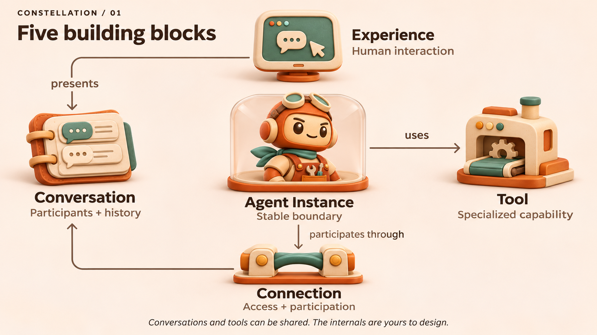
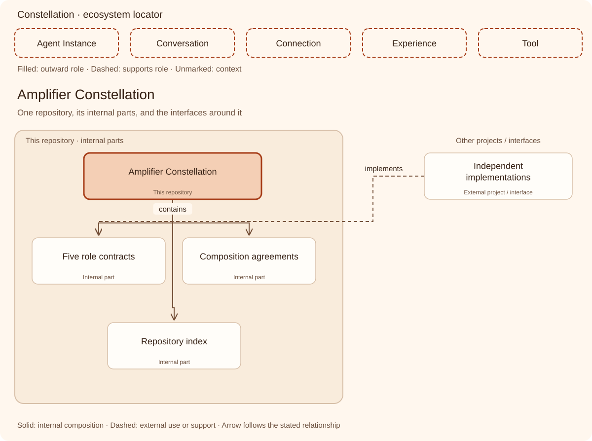

# Amplifier Constellation

Constellation connects persistent agents to the places people work. Its components
provide agent hosting, conversations, management, and connections to services such
as Slack, Teams, and Minecraft. Each can be used and developed independently.

## Get started

- **Explore the idea:** visit the [illustrated introduction](https://microsoft.github.io/amplifier-constellation/) or read the [vision](docs/VISION.md).
- **Set up and manage agents:** start with [Observatory](https://github.com/microsoft/amplifier-constellation-observatory).
- **Build with the components:** try the [request-to-result example](https://github.com/microsoft/amplifier-acp-lab/tree/main/examples/five_primitives), then follow the relevant repository below.

This repository is the family index and home of its shared agreements. Installation
instructions and supported interfaces live with each component.

## Find a component

| What you need | Repository |
| --- | --- |
| An installed agent's identity, configuration and lifecycle | [Instance](https://github.com/microsoft/amplifier-constellation-instance) |
| A reasoning and tool-execution engine | [Runtime](https://github.com/microsoft/amplifier-constellation-runtime) |
| Shared rooms, messages and agent coordination | [Conversations](https://github.com/microsoft/amplifier-constellation-conversations) |
| Live talk and sharing with an agent | [Companion](https://github.com/microsoft/amplifier-constellation-conversations/blob/main/docs/native-consumer-setup.md), currently in Conversations |
| Connections to other services | [Slack](https://github.com/microsoft/amplifier-acp-slack) · [Teams](https://github.com/microsoft/amplifier-acp-teams) · [Minecraft](https://github.com/microsoft/amplifier-acp-minecraft) |
| Portable communication and working-style profiles | [Persona Workshop](https://github.com/microsoft/amplifier-persona-workshop) |
| Examples and collaboration experiments | [ACP Lab](https://github.com/microsoft/amplifier-acp-lab) |
| A view of computers, agents and connections | [Observatory](https://github.com/microsoft/amplifier-constellation-observatory) |

[Amplifier Unified](https://github.com/microsoft/amplifier-unified) provides a
separate Amplifier workspace that can use these components. [Amplifier Agent](https://github.com/microsoft/amplifier-agent)
is another engine choice. See [family.toml](family.toml) for the full index.

## Join the work

Use the [contract map](contracts/README.md) to find the shared interfaces and
[Working together](docs/working-together.md) to coordinate changes across components.
The contracts describe outward behavior; they do not require one deployment layout
or a central provisioning service.

Constellation is part of the [Amplifier ecosystem](https://github.com/microsoft/amplifier).

<!-- ecosystem-map:start -->
## Where this fits

The family index and shared role contracts; implementations remain independent.

Supports: Agent Instance, Conversation, Connection, Tool, Experience.

[Product website](https://microsoft.github.io/amplifier-constellation/) · [Ecosystem map](https://microsoft.github.io/amplifier-constellation/projects/amplifier-constellation/) · [Open the map](docs/ecosystem-map.svg) · [Map guide](https://github.com/microsoft/amplifier-constellation/blob/main/docs/ecosystem-maps.md)

<!-- ecosystem-map:end -->

## Contributing

> [!NOTE]
> This project is not currently accepting external contributions, but we're actively working toward opening this up. We value community input and look forward to collaborating in the future. For now, feel free to fork and experiment!

Most contributions require you to agree to a
Contributor License Agreement (CLA) declaring that you have the right to, and actually do, grant us
the rights to use your contribution. For details, visit [Contributor License Agreements](https://cla.opensource.microsoft.com).

When you submit a pull request, a CLA bot will automatically determine whether you need to provide
a CLA and decorate the PR appropriately (e.g., status check, comment). Simply follow the instructions
provided by the bot. You will only need to do this once across all repos using our CLA.

This project has adopted the [Microsoft Open Source Code of Conduct](https://opensource.microsoft.com/codeofconduct/).
For more information see the [Code of Conduct FAQ](https://opensource.microsoft.com/codeofconduct/faq/) or
contact [opencode@microsoft.com](mailto:opencode@microsoft.com) with any additional questions or comments.

## Trademarks

This project may contain trademarks or logos for projects, products, or services. Authorized use of Microsoft
trademarks or logos is subject to and must follow
[Microsoft's Trademark & Brand Guidelines](https://www.microsoft.com/legal/intellectualproperty/trademarks/usage/general).
Use of Microsoft trademarks or logos in modified versions of this project must not cause confusion or imply Microsoft sponsorship.
Any use of third-party trademarks or logos are subject to those third-party's policies.
