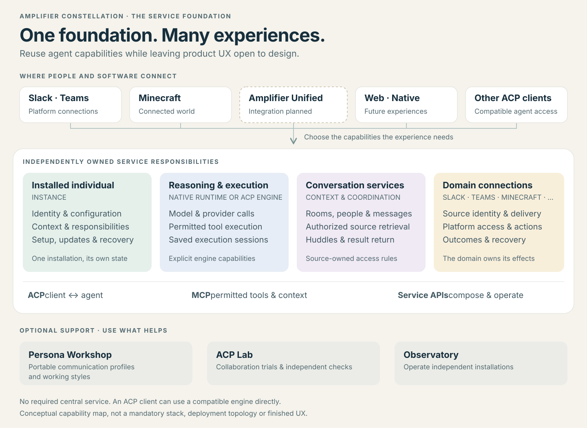

# Amplifier Constellation

Reusable services for persistent agents that work with people across their tools.

An installed agent can retain its identity and accepted responsibilities across
conversations, use authorized context, and coordinate with other agents.
Experiences connect to those capabilities through explicit interfaces. Each owner
can develop and operate their part without requiring a single application,
engine or central Constellation service.

This repository is the primary map and shared direction for the family. It does
not define the final product UX. Existing control panels and preview clients are
development and administration access; future experiences can take different forms.

## Get the lay of the land

| Start with | What it answers |
| --- | --- |
| [Vision](docs/VISION.md) | What are we trying to make possible, and why? |
| [Visual guide](docs/guide/README.md) · [browser tour](docs/guide/index.html) | What are the big parts, how do they connect, and where could I contribute? Open the tour locally; it is an explanatory document, not a running product. |
| [Design with the services](docs/guide/designing-with-services.md) | What does each part do, what passes between them, and how could my idea fit? |
| [Family agreement](contracts/family.v1-candidate.md) | What must remain dependable across independently owned parts? |
| [Working together](docs/working-together.md) | How do people lead areas with agents, use one another's expertise and handle changes? |
| [Contract map](contracts/README.md) | Which specific promise and interface matter for my next outcome? |

We use [Amplifier Converge](https://github.com/microsoft/amplifier-converge) as the
working method. Shared intent and agreements guide the work. Contributors inspect
current reality to choose the next useful outcome; this umbrella does not keep a
parallel release history or gap inventory.

## Find the owning component

| Capability | Repository |
| --- | --- |
| Installed identity, configuration, authorized context, responsibilities and lifecycle | [Instance](https://github.com/microsoft/amplifier-constellation-instance) |
| Native reasoning, model/provider integration, tools and durable execution sessions | [Runtime](https://github.com/microsoft/amplifier-constellation-runtime) |
| Conversation, membership, message, context and observable coordination services | [Conversations](https://github.com/microsoft/amplifier-constellation-conversations) |
| Connections to external conversations and domain actions | [Slack](https://github.com/microsoft/amplifier-acp-slack) · [Teams](https://github.com/microsoft/amplifier-acp-teams) · [Minecraft](https://github.com/microsoft/amplifier-acp-minecraft) |
| Portable communication and working-style profiles | [Persona Workshop](https://github.com/microsoft/amplifier-persona-workshop) |
| Independent collaboration experiments and outcome checks | [ACP Lab](https://github.com/microsoft/amplifier-acp-lab) |
| Optional administration across independent installations | [Observatory](https://github.com/microsoft/amplifier-constellation-observatory) |

[family.toml](family.toml) is the machine-readable repository map. Its existing
components, related products and planned homes are separate; an entry does not
claim an interface is implemented or an extraction is complete. The small
[ACP connection library](crates/acp-connection/README.md) is a shared code
integration, not a required running service. Concrete APIs, setup instructions,
compatibility and tests belong to their component owners.

Slack, Teams and Minecraft connect their platforms. Bespoke web/native products
can compose the same services. [Amplifier Unified](https://github.com/microsoft/amplifier-unified)
is an existing product with a planned Constellation connection.
The native Runtime and the separate [Amplifier Agent](https://github.com/microsoft/amplifier-agent)
are distinct engines. Standard ACP and negotiated capabilities allow alternatives.

## Products and shared platform homes

The [family agreement](contracts/family.v1-candidate.md#planned-products-platforms-and-clients)
defines the intended ownership split. These are planned homes or extractions,
not an availability report. The repository names below are under `microsoft/`.

| Area | Intended homes |
| --- | --- |
| Companion product | `amplifier-companion`; the preview currently lives in Conversations |
| Shared work and outputs | `amplifier-platform-scheduling`, `amplifier-platform-workspaces`, `amplifier-platform-resources`, `amplifier-platform-operations`, `amplifier-platform-publishing`, `amplifier-platform-portability` |
| Shared interaction and information | `amplifier-platform-canvas`, `amplifier-platform-realtime`, `amplifier-platform-context` |
| Browser and native client foundations | `amplifier-client-web`, `amplifier-client-windows`, `amplifier-client-linux`, `amplifier-client-macos`, `amplifier-client-ios`, `amplifier-client-android` |

Use these shared capabilities across Unified and Constellation experiences where
their interfaces fit. Conversations remains the owner of rooms, membership,
messages and huddles. Detailed platform contracts stay with their serving owners;
this index links them rather than keeping another copy. Repository separation
does not require a separate running service for each capability.

## Make a contribution fit

Start from the current vision and the boundary you will change. Name the outcome,
owner, authority and integrated check in the existing assignment or PR. Local
implementation decisions stay with that owner. A change to a shared promise
identifies affected consumers and is settled with the responsible owners before
dependent work relies on it.

Accepted design commitments retain their scope; a new proposal or a diagram
does not ratify new interfaces. Read only the
contracts relevant to your work. Keep implementation details and private evidence
out of the shared vision, and evaluate actual behavior when making a claim.

Constellation is part of the broader [Amplifier ecosystem](https://github.com/microsoft/amplifier).

## Contributing

> [!NOTE]
> This project is not currently accepting external contributions, but we're actively working toward opening this up. We value community input and look forward to collaborating in the future. For now, feel free to fork and experiment!

Most contributions require you to agree to a
Contributor License Agreement (CLA) declaring that you have the right to, and actually do, grant us
the rights to use your contribution. For details, visit [Contributor License Agreements](https://cla.opensource.microsoft.com).

When you submit a pull request, a CLA bot will automatically determine whether you need to provide
a CLA and decorate the PR appropriately (e.g., status check, comment). Simply follow the instructions
provided by the bot. You will only need to do this once across all repos using our CLA.

This project has adopted the [Microsoft Open Source Code of Conduct](https://opensource.microsoft.com/codeofconduct/).
For more information see the [Code of Conduct FAQ](https://opensource.microsoft.com/codeofconduct/faq/) or
contact [opencode@microsoft.com](mailto:opencode@microsoft.com) with any additional questions or comments.

## Trademarks

This project may contain trademarks or logos for projects, products, or services. Authorized use of Microsoft
trademarks or logos is subject to and must follow
[Microsoft's Trademark & Brand Guidelines](https://www.microsoft.com/legal/intellectualproperty/trademarks/usage/general).
Use of Microsoft trademarks or logos in modified versions of this project must not cause confusion or imply Microsoft sponsorship.
Any use of third-party trademarks or logos are subject to those third-party's policies.
