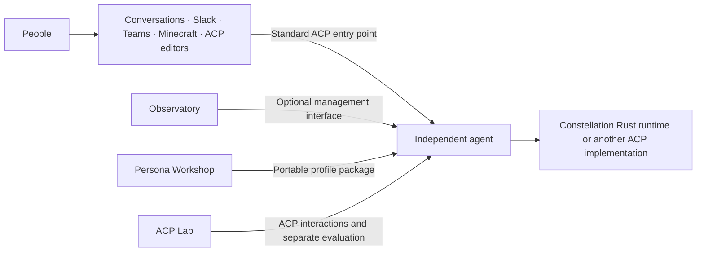

# Amplifier Constellation

Independent, persistent agents working with people across their tools.

An agent can be your personal assistant, a team coordinator, a project lead, or a
specialist. You can talk to the same individual in a browser, a Slack conversation,
or an ACP-compatible editor. Its identity and responsibilities continue across
those places, while each conversation keeps its own audience and access rules.

This repository is the starting point for the Constellation family. It holds the
vision, the component map, and the agreements between components. Each application,
agent implementation, and connector has its own repository and release cycle.

## Start here

| You want to… | Start with |
| --- | --- |
| Install and configure one independent agent | [Agent Instance](https://github.com/microsoft/amplifier-constellation-instance) |
| Manage agents across machines | [Observatory](https://github.com/microsoft/amplifier-constellation-observatory) |
| Talk with people and agents in a browser | [Conversations](https://github.com/microsoft/amplifier-constellation-conversations) |
| Connect an ACP agent to Slack or Teams | [Slack](https://github.com/microsoft/amplifier-acp-slack) · [Teams](https://github.com/microsoft/amplifier-acp-teams) |
| Let independent agents participate in Minecraft | [Minecraft adapter](https://github.com/microsoft/amplifier-acp-minecraft) |
| Build a communication and working-style profile | [Persona Workshop](https://github.com/microsoft/amplifier-persona-workshop) |
| Run repeatable collaboration experiments | [ACP Lab](https://github.com/microsoft/amplifier-acp-lab) |
| Embed or extend our native Rust agent engine | [Runtime](https://github.com/microsoft/amplifier-constellation-runtime) |

These are experimental, independently usable components. This repository holds
documentation, a component registry, and a small compiled ACP SDK integration
used by the Rust components. Follow a component's README for its
installation instructions, supported platforms, and release availability.

## How the pieces fit

**Runtime** provides the model and tool loop and saved working sessions.
**Instance** gives an installed individual its identity, configuration, profiles,
service lifecycle, and management UI. The two can be installed together; their
implementation boundary stays replaceable. The native runtime does not require
Codex. Other ACP implementations remain useful peers.

The coordinated runtime documentation includes a
[current-design overview and diagram](https://github.com/microsoft/amplifier-constellation-runtime/blob/main/docs/runtime-overview.md)
and a separate
[next execution design](https://github.com/microsoft/amplifier-constellation-runtime/blob/main/docs/steering-design.md).
The latter describes repeated input and steering; it is not a claim about the
capabilities of runtime 0.9.0 or an older installation.

An experience owns its conversations and presentation. A connector translates
its platform's messages, threads, permissions, and formatting into the supported
ACP interaction. Authorized recall across conversations is an optional context
integration; ACP alone does not grant access to another room's history.

The fleet dashboard is a convenient way to reach independent services. An agent
does not need the dashboard to keep existing or to accept another authorized ACP
client. Installing one individual must not require installing the whole family.
Setup and ongoing connection management must also work without a shared
Constellation provisioning service. Each owner can operate and update their
installations independently; fleet interfaces remain optional. See the
[self-contained installation baseline](contracts/family.v1-candidate.md#self-contained-installation-baseline).

## Direction and agreements

- [Vision](docs/VISION.md): the experience we are working toward.
- [Shared spaces proposal](docs/shared-spaces-design.md): approachable setup, everyday work, recovery, and voice operation; design for discussion.
- [Execution environments proposal](docs/execution-environments.md): separate agent identity, project execution, hosting, and credentials; under discussion.
- [Family contract](contracts/family.v1-candidate.md): ownership, independence,
  compatibility, and replacement of components.
- [Experience contract](contracts/experience.v1-candidate.md): conversation scope,
  human and programmatic controls, participation, and evidence of outcomes.
- [Input continuity](contracts/input-continuity.v1-candidate.md): contract for follow-ups during ongoing work, preserved effects and explicit stop.
- [Model support](contracts/model-support.v1-candidate.md): accepted policy for
  current models by class, verified capabilities and explicit configuration changes.
- [Contract index](contracts/README.md): which repository owns each detailed seam.
- [Component registry](family.toml): the machine-readable map of repositories.
- [Implementation status](docs/STATUS.md): current evidence and outstanding work.
- [ACP SDK integration](docs/acp-sdk-integration.md): protocol ownership,
  compatibility checks, and the remaining application wrappers.

The vision and umbrella contracts are **drafts for review**. A desired behavior,
an implemented feature, and a verified result are recorded separately. Work comes
from the gaps between them. Component APIs and tests remain authoritative for
what a particular release implements.

## Working on the family

Start with the component that owns the behavior. Changes inside a component stay
there. Propose a change here when it changes the responsibilities or expectations
between components; include an example and the observations that would prove it.
Keep detailed API schemas, release artifacts, and implementation tests with their
owning component.

Constellation is an experimental part of the broader
[Amplifier ecosystem](https://github.com/microsoft/amplifier). Its Rust runtime is
one implementation; it does not rename or replace the separate
[Amplifier Agent](https://github.com/microsoft/amplifier-agent) project.

## Contributing

> [!NOTE]
> This project is not currently accepting external contributions, but we're actively working toward opening this up. We value community input and look forward to collaborating in the future. For now, feel free to fork and experiment!

Most contributions require you to agree to a
Contributor License Agreement (CLA) declaring that you have the right to, and actually do, grant us
the rights to use your contribution. For details, visit [Contributor License Agreements](https://cla.opensource.microsoft.com).

When you submit a pull request, a CLA bot will automatically determine whether you need to provide
a CLA and decorate the PR appropriately (e.g., status check, comment). Simply follow the instructions
provided by the bot. You will only need to do this once across all repos using our CLA.

This project has adopted the [Microsoft Open Source Code of Conduct](https://opensource.microsoft.com/codeofconduct/).
For more information see the [Code of Conduct FAQ](https://opensource.microsoft.com/codeofconduct/faq/) or
contact [opencode@microsoft.com](mailto:opencode@microsoft.com) with any additional questions or comments.

## Trademarks

This project may contain trademarks or logos for projects, products, or services. Authorized use of Microsoft
trademarks or logos is subject to and must follow
[Microsoft's Trademark & Brand Guidelines](https://www.microsoft.com/legal/intellectualproperty/trademarks/usage/general).
Use of Microsoft trademarks or logos in modified versions of this project must not cause confusion or imply Microsoft sponsorship.
Any use of third-party trademarks or logos are subject to those third-party's policies.

Installation-owned updates are described in the
[update contract](contracts/installation-updates.v1-candidate.md): dashboard,
CLI and chat requests share the same controls, with optional fleet observation
and no required shared update service.

The optional [refreshed context contract](contracts/context-snapshots.v1-candidate.md)
keeps current source projections concise while preserving original requests,
private history and tool outcomes.

The [harness lifecycle contract](contracts/harness-lifecycle.v1-candidate.md)
separates durable conversation history, provider working context, tool deadlines,
connection health and assignment authority. It also defines optional source-delivery
receipts, settled maintenance, and public commentary/status across experiences.

Saved service setup and Connect/Disconnect controls follow the [service connections contract](contracts/service-connections.v1-candidate.md). Domain installations retain credentials, sessions and lifecycle ownership; the optional Instance registry exposes saved entries and fixed owner actions without a host-shell API.
