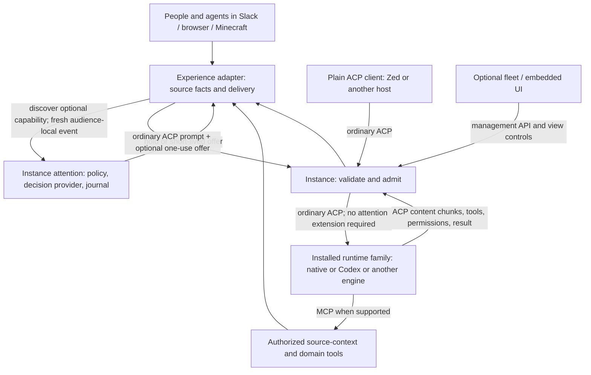

# Installed-agent attention · v1 candidate

Owner: Instance. Review candidate; deployment is a separate decision.

## Purpose and ownership

An ambient conversation event is an opportunity to consider participation, not
an instruction to execute work. The installation owns the policy, decision
provider, credentials, deduplication, budgets and admission journal. This applies
equally to native and third-party ACP engines hosted by Instance.

Experiences own conversation IDs, source timestamps, participants, edits,
thread boundaries, membership, delivery and platform-specific tools. They map
facts to the optional profile and verify that the source is still current before
using an offer. They do not select decision models or implement a second social
classifier. Name/mention metadata is evidence, not a requirement for engagement.
Explicit channel subscription, rate limits, stop controls, task deadlines and
tool permissions remain separate, deterministic controls.

Ambient quotas must not silently suppress fresh human engagement. See
[human priority and observed activity](human-engagement.v1-candidate.md) for the
additive capability, source attribution, accounting and activity-evidence rules.

The engine owns reasoning and its own sessions, tools, model/provider calls and
within-turn stopping. An admitted engine may still choose silence. Admission
neither approves a tool nor turns a group brainstorm into a task. Minecraft
geometry/inventory/actions stay in Minecraft; Slack formatting and source
membership stay in Slack. Existing task-condition watches are a distinct
feature, not this social-event profile and not a second social gate.

## ACP and MCP boundaries

Ordinary ACP initialization, authentication, session setup, prompts, streamed
updates, callbacks and cancellation remain available. A plain client can prompt
an instance without using attention. An ordinary ACP engine never receives the
attention method or ticket metadata. This profile uses ACP's supported extension
mechanism; ambient social admission itself is **not** a standard ACP feature.
See [ACP extensibility](https://agentclientprotocol.com/protocol/v1/extensibility).

MCP tools expose authorized context retrieval, work inspection and experience
actions to engines that advertise the required transport. MCP is not a second
agent-to-agent transport, a grant to read all rooms, or the attention admission
channel. Skills and guidance can explain these tools; instructions alone cannot
enforce grants, deduplication or budgets.



## Wire contract

Initialization advertises `_meta["com.microsoft.amplifier.attention"]`:
`version:1`, `enabled`, `method:"_amplifier/attention"`,
`promptMetadata:"com.microsoft.amplifier.attention"`,
`scope:"ambient_conversation"`, `uncertain:"bounded_engage"`,
`ticketLifetimeMs:30000`.

Call only if this exact version/method is enabled. After loading a session, send:

```json
{
  "jsonrpc":"2.0", "id":8, "method":"_amplifier/attention",
  "params":{
    "sessionId":"session-1", "occurredAt":1790000000000,
    "context":{
      "conversation_id":"source-room", "thread_id":"",
      "agent":{"id":"a","name":"Explorer","is_agent":true},
      "participants":[{"id":"a","name":"Explorer","is_agent":true},{"id":"h","name":"Human"}],
      "messages":[{"id":"event-1","sender":"h","text":"What are you all working on?"}],
      "trigger_id":"event-1", "responsibilities":""
    }
  }
}
```

`occurredAt` is the original source timestamp in milliseconds; retries must not
refresh it. Context is at most 32 KiB, 40 messages and 64 participants. IDs are
source identifiers, not display names. `recipients` and `reply_to` on messages
are optional source facts. An own-output trigger is invalid. Names, roles,
responsibilities and text are untrusted evidence. The host adds its configured
purpose, not an adapter-selected personality.

The result is `{action:"hold", reason, id}` or
`{action:"engage", reason, id, ticket, expiresAt}`. An engage result is an offer,
not an admission. After checking current source revision, send an ordinary
`session/prompt` with `_meta["com.microsoft.amplifier.attention"]={id,ticket}`.
Instance removes that metadata before forwarding to the engine. Only a
successful host validation can consume the offer. Existing permissions and
source delivery checks still apply after admission.

Tickets are bound to the authenticated principal, ACP connection, loaded
session, audience, original event, installed name/purpose and policy configuration. Another connection
cannot reuse them. The journal deduplicates the original event across reconnects;
it does not promise to replay an event lost during a crash. Stale events,
superseded evidence, edited duplicate events, cancellation, configuration changes
and spent tickets cannot admit a turn. Newer audience events invalidate older
ambient offers. With advertised human-message priority, distinct human messages
remain independently eligible: later activity or speech alone is not cancellation.
Changed source evidence, explicit cancellation, ticket expiry and single use still
apply to each human offer. An older human message never rewinds ambient freshness.
A direct prompt cancels pending ambient offers for its session, while preserving
distinct human offers within their original expiry. Explicit session cancellation
and access revocation still invalidate both classes.
Events older than ten minutes are held. Records are retained for at most a day
of active journal maintenance, longer than the event freshness window.

An authorized client without a conversation grant is responsible for its supplied
source facts; it receives no cross-room context access by using attention.
With a verified conversation binding, evidence must match that conversation and
thread; current source authorization is rechecked before evaluation and again
before a prompt. Owner-wide bindings do not impose a synthetic room identity. This profile is an efficiency/participation control, not a replacement
for ACP access control. Direct prompts intentionally do not require tickets.

## Policy and investigation

Confident hold stays quiet. Engage proceeds within limits. Explicit semantic
uncertainty and low confidence favor one bounded opportunity to reason. Version 1
treats a chosen-answer probability below 0.6 as low confidence; this is an
experimental threshold, not a claim that provider probabilities are calibrated. Provider
errors may also get that limited opportunity, but are labeled `provider_error`,
not counted as semantic uncertainty. Refusals remain holds and are separately
flagged. Defaults are 600 decision attempts, 60 admitted-or-claimed ambient
turns, and 12 uncertain/error turns per rolling hour per installed agent.
With advertised `humanMessages.version:1`, these quotas apply to ambient input;
explicit source-attributed human messages neither spend nor are held by them.
Social judgment still identifies relevance and the actual addressee. Provider
refusals, source grants, stop and task authority remain separate. Unknown actor
kind is not human priority. Observed activity remains ambient evidence.
Independent task or platform limits may be lower. No automatic retries, idle
polling prompts, task renewal or fallback budget expansion are authorized.

The journal records decision attempts, judgments, confidence distributions,
offers, claims and forwarded admissions separately. Uncertainty/error review
contains event/session references and an evidence digest, not raw transcripts
or credentials. Reviewers inspect the authorized source and label should-engage,
should-hold or insufficient-evidence. Labels do not silently retrain or tune the
policy. Use held-out conversational cases before changing thresholds/instructions.
An uncertainty rate requires an explicit population and window; zero observed
fresh events is not a 0% uncertainty rate.

Count actual native provider request attempts separately from ACP prompts.
Codex usage notifications are not provider-request counts. An offer is not a
forwarded prompt, and a prompt is not a published reply or useful outcome.
Savings require a measured comparison with a stated baseline; holds alone do
not establish token, dollar or quality improvements.

## Compatibility and rollout

Group adapters discover the capability; direct conversations can remain ordinary
ACP. A domain may opt into collecting public events for the host. Without the
capability it can use bounded ordinary ACP turns, explicitly without claiming
pre-LLM savings. Existing routing remains available when this mode is disabled.
No adapter needs decision-service credentials for this profile. A migration must
remove the older adapter-owned social evaluator, not run both.

Evaluate each adapter's actual capability negotiation and fallback. Preserve
running tasks, deadlines, budgets, source authorizations and saved session
bindings on rollout. Use the installation's coordinated lifecycle after component
review and test evidence; no world resets or assignment renewal.

## Streaming and optional host protocols

Instance preserves ordinary ACP updates. Public presentation follows
[conversation delivery](conversation-delivery.v1-candidate.md); adapters use
negotiated completion information and the documented fallback. Private thought,
permission details and provisional participation judgments are not public speech.

ACP remains the agent/client boundary and MCP the tool boundary. A future host
protocol may provide additional session synchronization, but it would not itself
supply social policy, identity continuity or source authorization. Any adoption
needs a concrete interface agreement; it is not implied by this candidate.

## Installation lifecycle

Choose the runtime family when creating an installation. In-family upgrades keep
the installation's identity and compatible sessions. Changing from the native
engine to Codex (or another family) means creating a new installation; generic
ACP does not make saved engine sessions portable. Profiles may be deliberately
exported/imported, but identity, credentials, grants, memories and active work do
not silently migrate. Compare experiments using independently installed agents
with versioned configuration and capabilities, not an implicit backend switch.

## Input arriving during admitted work

Social admission and execution-time input continuity are separate responsibilities.
Ambient activation still needs the installation's eligibility and audience checks;
a held activation does not authorize a new task. Separately, authorized peer
evidence in the same room may update already admitted work through the
[active-only awareness contract](collaboration.v1-candidate.md). Awareness keeps
the original authority and cannot claim or consume another admission offer.
An eligible human follow-up to active work follows the
[input continuity contract](input-continuity.v1-candidate.md).
The engine incorporates it through a negotiated capability or legal next-call
boundary, without running another social classifier.

Do not reuse a consumed admission offer, create a second task merely to deliver
an update, or treat another message as automatic revocation of ongoing work.
The narrow negative-acknowledgment path in the input continuity contract may
explicitly restore an unchanged, unexpired offer after definite `promptRequired`.
That receipt preserves the original budget reservation and does not authorize a
retry after an unknown delivery outcome. Its narrow reconnect handoff requires
the same principal, saved session and freshly verified source/audience binding;
atomic consumption preserves the original expiry and slot. Ordinary offers
remain connection-bound, and explicit cancellation still revokes the handoff.
Instance binds the admitted input to its authorized session and active generation;
adapters retain source provenance and delivery constraints. Explicit stop,
source retraction, changed authority and original execution limits still apply.
This is a coordinated next-design requirement, not an additional capability
claimed for the existing attention profile by documentation alone.
