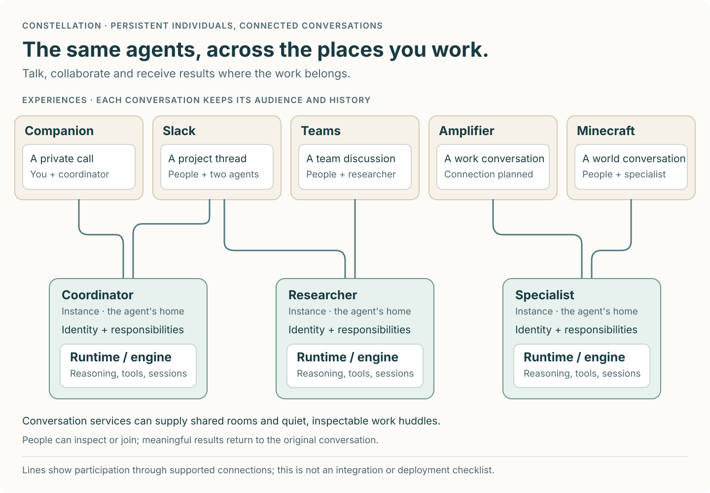

# Your agents, wherever you work

Constellation lets people work with a team of persistent agents across the places
where life and work happen. Return to a familiar collaborator, bring in a
specialist, redirect work and receive useful results without relaying every
exchange yourself.

Our ambition is to give a small group the reach of a much larger organization.
Human attention goes toward direction, judgment, expertise and taste. Agents carry
preparation, execution, coordination and follow-through within their responsibilities.

## A team connected to your conversations

One agent can participate in several conversations; several agents can share a
conversation. Each keeps its own audience and access rules. The picture explains
the intended relationships, rather than prescribing a screen or certifying every
integration.

## What each part means

| Part | What it brings to people |
| --- | --- |
| **Agent** | A continuing collaborator with a recognizable identity and accepted responsibilities. |
| **Instance** | That agent's home: its identity, configuration, connections and responsibilities, with a selected engine inside. |
| **Runtime / engine** | The ability to reason, use tools and continue work. Options include Constellation Runtime, Codex, Claude, GitHub Copilot and Amplifier Agent through compatible ACP implementations. |
| **Experience** | A place to interact: Companion, Slack, Teams, Minecraft, Amplifier or another application. |
| **Conversation** | An exchange with participants, an audience and history, hosted by an experience or its supporting service. |
| **Domain connection** | A bridge carrying requests, responses and permitted actions between an agent and a place where work happens. |
| **Conversation services** | Reusable rooms, membership, messages and inspectable work huddles. Existing platforms keep their own conversations. |
| **Observatory** | A fleet view: understand which agents are available, where they are connected, what they are doing and what needs attention; manage them through their exposed controls. |

**Companion brings your agent into your physical world.** Talk naturally, let it
see what you choose to share, and work through things together in a live call.
Begin with one person and one agent; grow toward shared calls where several
people and agents can participate together.

**Amplifier** is one connected experience with its own ecosystem. Its internal
clients and platforms stay outside this map. **Amplifier Agent** is a separate
engine option. Likewise, Observatory complements the places where people work;
it is not a required control center for every interaction.

## What passes between the parts

People give direction through an experience. A connection carries the attributed
input, relevant permitted context and return destination to the agent's home.
The home talks to its engine through **ACP**; tools and context are exposed
through **MCP** or a supported service interface. Results return to the intended
conversation. Observatory uses installations' management interfaces to observe
and manage them without taking ownership of their state or permissions.

The [family agreement](../contracts/composition.md#what-crosses-each-connection)
defines these boundaries; each serving component owns its exact API.

## What working together should feel like

Ask a coordinator in Slack to prepare a customer briefing. It works with a
researcher and a specialist in a quiet, observable huddle. You can inspect or join
without receiving every exchange. A changed deadline reaches the work; useful
progress survives. The briefing and decisions needing your judgment return to
the original conversation. Later, discuss them with the same coordinator in
Companion, within the access allowed there.

## Principles

- **Value human attention.** Coordinate quietly, remain inspectable and bring back
  meaningful progress, decisions and results. Make room for lively shared work
  when people want to participate.
- **Keep the parts independently useful.** Installations own their setup, state
  and recovery. Engine choice, machine and release can vary; a central fleet
  service is optional.
- **Share capabilities, preserve boundaries.** Familiar identity does not merge
  private conversations or grant permission to act. Services expose dependable
  interfaces that different experiences can reuse.
- **Prefer simpler compositions.** Reuse before adding systems, restrictions or
  repeated context. Persona Workshop, ACP Lab, and reusable context and live-media
  capabilities support the ecosystem without becoming universal prerequisites.
- **Judge useful outcomes.** Check actual results, correction and recovery—not
  just acknowledgments. Count administrator effort alongside end-user effort.

The bet is that persistent collaborators and reusable services improve useful
work while reducing human coordination. Test that against real journeys and
revise the design when it does not. Today's admin panels and previews do not set
the future product UX.

[Contracts](../contracts/README.md) hold the shared promises.
[Converge](https://github.com/microsoft/amplifier-converge) guides how we develop
them together; the [repository map](../family.toml) locates their owners.
