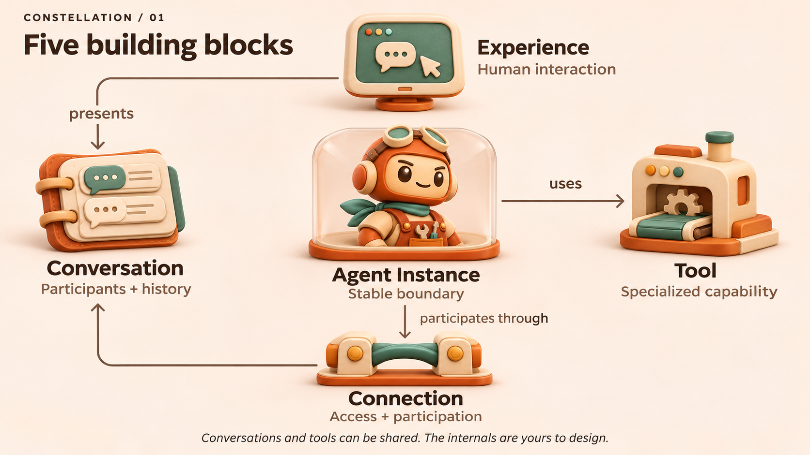

# Your agents, wherever you work

Constellation lets people work with persistent agents across the places where
life and work happen. Return to a familiar collaborator, bring in a specialist,
redirect work and receive useful results without relaying every exchange yourself.
A small group should gain the reach of a much larger organization while spending
its attention on direction, judgment, expertise and taste.

## Five building blocks, room to invent

| Primitive | What it makes possible |
| --- | --- |
| **[Agent Instance](../contracts/agent-instance.md)** | A continuing agent you can address and entrust with work, with a dependable outward identity and freedom inside. |
| **[Conversation](../contracts/conversation.md)** | An exchange with participants, an audience and history that people and agents can return to through different views. |
| **[Connection](../contracts/connection.md)** | Authorized participation and supported actions in a place where work happens. |
| **[Experience](../contracts/experience.md)** | The human-facing way to talk, see, direct, inspect or manage. |
| **[Tool](../contracts/tool.md)** | A capability an agent can use, from a search to a software factory or media pipeline. |

People meet agents through Conversations presented by Experiences. Connections
bring agents into those exchanges and environments; agents use Tools to accomplish
work. Management and observation can also use service controls directly.

These are composable roles, not five required services or repositories. Agents can
share conversations and tools. A product can offer an app, collaborating agents
and callable capabilities around the same work. Inside an agent, use one engine
such as Constellation Runtime, Amplifier Agent, Codex, Claude or GitHub Copilot,
an inner team, or a different architecture. Those are examples, not a fixed menu;
a machine or container does not define the agent's boundary.

## What working together should feel like

Ask an agent in Slack to prepare a customer briefing. It gathers specialists in
a quiet, inspectable huddle and uses a research tool. Join, correct the direction
or let them continue. Meaningful progress, important disagreements and the briefing
return to the original conversation. Discuss the same work later through another
authorized experience.

Companion brings an agent into your physical world through a live call: talk,
share what you choose to let it see, and work together. Grow from one person and
one agent toward shared calls. Slack, Teams, Minecraft and Amplifier offer other
ways in. Observatory makes systems and connections visible and manageable. New
experiences can reuse the same parts; none is a mandatory front door.

## Principles

- **Value human attention.** Coordinate quietly, remain inspectable, and return
  meaningful progress, decisions and results. Welcome lively shared work when wanted.
- **Reuse good parts; leave room to invent.** Keep outward promises dependable
  while owners choose their internals independently.
- **Preserve continuity and scope.** Familiar identity does not merge audiences
  or permissions. Correction and recovery preserve useful work.
- **Keep it approachable.** Start on the computer people have. Measure setup,
  recovery and administrator effort alongside everyday use.
- **Prefer simpler compositions.** Reuse before adding systems or restrictions.
  Judge useful outcomes, including failure and recovery, rather than activity alone.

Test whether this reduces human coordination and improves what a small team can
accomplish. Revise what fails to help. Illustrations explain relationships;
products and agent architectures remain open to invention.

[Contracts](../contracts/README.md) define the promises; the
[component map](../README.md#find-the-owning-component) locates implementations.
[Converge](https://github.com/microsoft/amplifier-converge) guides their development.
