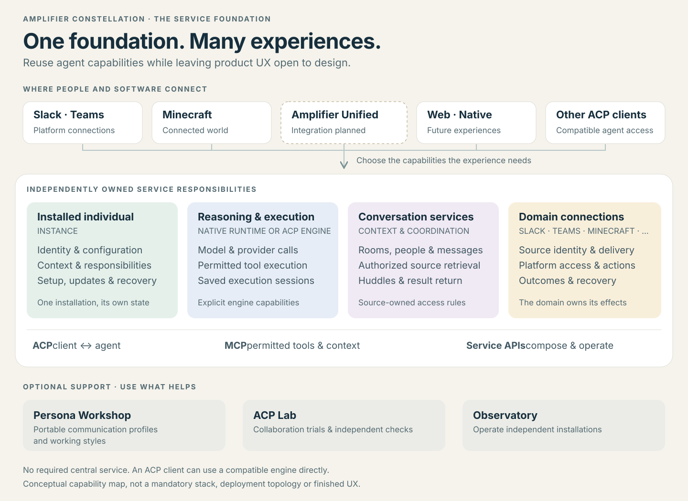
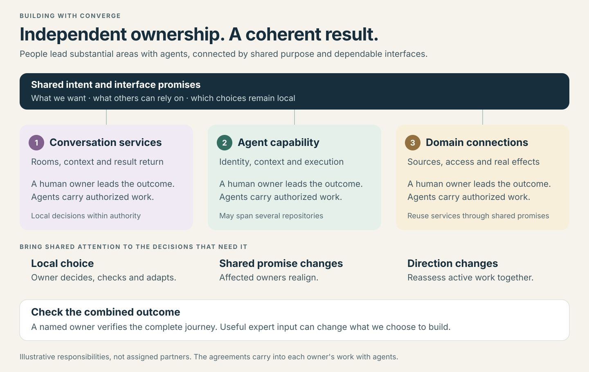

# The Constellation guide

**The idea:** make persistent agent capabilities reusable across experiences,
so each new product or connection does not have to rebuild the whole system.
People and independent service owners can keep improving their areas while
relying on clear promises between them.

[Open the visual tour](index.html) locally for a presentation view. The diagrams
below also work on GitHub. The tour and its two SVG files can be opened together
without a server; its source-reference links open the canonical documents online.
Use the browser's **Print → Save as PDF** for a portable handout. Printing includes
all interface cards, even when collapsed, and restores the screen afterward.
Turn off the browser's print headers and footers to omit the local file path.
The PDF is an export of this guide, not a separately maintained document.

This guide explains the
[vision](../VISION.md) and [shared agreements](../../contracts/README.md); it does
not define another API or a finished product interface.

To develop an idea, use [Designing with the services](designing-with-services.md):
what each part does, what its interfaces carry, where information belongs, and a
worked example that connects the parts.

## The big parts

Think of these as capabilities that can be composed, not a required stack to
install together. **Companion is a product with its own planned repository**; its
existing preview is currently implemented beside the Conversations service.
**Unified is an existing product** with a planned Constellation connection.
Their product experiences remain distinct from shared services and reusable
client foundations. Current administration screens do not prescribe their UX.

| Part | What it contributes | Where its responsibility ends |
| --- | --- | --- |
| **Instance: an installed individual** | Stable identity, owner configuration, scoped context, responsibilities, attention policy and lifecycle controls. | It does not become the platform's conversation store or replace the engine's model/tool loop. |
| **Engine: reasoning and execution** | Turns an admitted request and permitted context into model calls, tool use and durable session evidence. Native Runtime or another ACP engine can fill this role. | It does not decide Slack membership, game permissions or another installation's administration. |
| **Conversation and context services** | Addressable conversations, participants, messages, authorized retrieval, coordination rooms and a return path for results. Sources retain their own access rules. | Sharing an agent identity or a room does not combine every transcript or authorize work. |
| **Domain connections** | Translate platform events and source identity; deliver replies; expose authorized actions and context. Slack, Teams and Minecraft have their own adapters. | They use the agent boundary rather than each owning another reasoning engine or shared social classifier. |

In everyday terms: Instance answers **which assistant this is**; the engine
provides **how it reasons and uses tools**; conversation services provide **where
people and agents can discuss and inspect work**; domain connections provide
**how it reads and acts in existing systems**. An experience shapes **how a person
works with those capabilities**.

Optional supporting parts prepare portable profiles (**Persona Workshop**),
exercise collaboration and independently check outcomes (**ACP Lab**), and
operate several installations through their exposed controls (**Observatory**).
They are reusable tools, not prerequisites for an agent to exist or respond.

### Reuse the planned platform and client foundations

The [planned ownership boundaries](../../contracts/family.v1-candidate.md#planned-products-platforms-and-clients)
explain how the new repositories fit. The groups below are a reading aid, not new
API definitions. Planned homes describe intended extraction and adoption, not
a verified repository-availability inventory or implemented integrations.

| Group | Planned repository homes | How an experience could use them |
| --- | --- | --- |
| **Companion product** | `amplifier-companion` | Own calls, shared presentation and meaningful work follow-through while consuming shared capabilities. |
| **Organize work and its evidence** | `amplifier-platform-scheduling`, `amplifier-platform-workspaces`, `amplifier-platform-resources`, `amplifier-platform-operations` | Reuse scheduling, workspaces, files/artifacts and durable operation observations while the engine and domain retain execution and effect authority. |
| **Create, release and carry** | `amplifier-platform-canvas`, `amplifier-platform-publishing`, `amplifier-platform-portability` | Compose shared canvas, built-output preview/release and portability capabilities instead of rebuilding them inside each experience. |
| **Live and relevant input** | `amplifier-platform-realtime`, `amplifier-platform-context` | Reuse live-media and authorized context access; source access rules and backend reasoning ownership remain distinct. |
| **Client foundations** | `amplifier-client-web`, `amplifier-client-windows`, `amplifier-client-macos`, `amplifier-client-linux`, `amplifier-client-ios`, `amplifier-client-android` | Share client support across products without treating each operating system as a separate product or service. |

Conversations continues to own its rooms, membership, messages and huddles. A
planned Companion repository does not create a second conversation service.
The [repository map](../../family.toml) locates the existing and planned homes;
concrete APIs belong to their serving owners. External ACP clients can also use
compatible engines directly, without Instance.

## Three kinds of interface

| Interface | Plain-language job | Typical exchanges | Owning reference |
| --- | --- | --- | --- |
| **ACP — Agent Client Protocol** | Conduct a conversation with an agent engine. | Discover capabilities; create or load a supported session; submit input; receive output/tool activity; handle permissions; cancel explicitly. | [Protocol and SDK agreement](../../contracts/protocol-sdk.v1-candidate.md), [Instance boundary](https://github.com/microsoft/amplifier-constellation-instance/blob/main/docs/acp-boundary.md) |
| **MCP — Model Context Protocol** | Expose tools and context an agent is permitted to use. | Discover tools; read a source; invoke a domain action; inspect its result. Tool availability alone grants no authority. | [Runtime tool connections](https://github.com/microsoft/amplifier-constellation-runtime/blob/main/docs/architecture.md#model-and-tools), [source continuity](https://github.com/microsoft/amplifier-constellation-instance/blob/main/docs/conversation-continuity.md) |
| **Owned service APIs** | Operate a service and compose it into an experience. | Manage identity or connections; query conversations and source records; inspect work; request supported lifecycle operations. | [Instance API](https://github.com/microsoft/amplifier-constellation-instance/blob/main/docs/api.md), [Conversations API](https://github.com/microsoft/amplifier-constellation-conversations/blob/main/docs/api.md) |

These interfaces have different jobs. ACP does not provision a fleet. MCP does
not establish trust between everyone who can discover a tool. A service API is
owned and versioned by that service; it is not automatically part of ACP.

A connector may play two roles: an **ACP client** bringing platform input to an
agent, and a **tool/context service** giving that agent authorized ways to read
or act in the platform. This is why a Minecraft connection can both deliver a
person's request and implement the actual game action.

Backend reasoning-provider protocols live behind the engine boundary. The native
Rust Runtime integrates providers directly. A separately chosen ACP engine, including
Amplifier Agent, keeps its own provider/dependency implementation. Consumers
negotiate what the chosen engine supports instead of assuming all engines are
interchangeable in every feature or saved-session format.

An experience can use the planned Realtime capability for voice or media transport
while owning its interaction design. That does not move backend reasoning out of
the selected engine or make media protocols part of ACP. The current implementation
and supported interface still need to be checked with their owner.

## Follow one piece of work

This is an illustrative composition, not a prescribed screen flow. The same
service meanings should survive a different product design.

| Step | What crosses the boundary | What must stay true |
| --- | --- | --- |
| **1. A person asks** | An experience or connector retains the actual author, source, conversation, destination and request. | A peer's suggestion or quoted human message is not fresh human authorization. |
| **2. The agent receives it** | A client submits an ACP interaction, optionally through Instance's identity/context services. | Audience, supported capabilities and existing work authority are preserved. Acceptance is not completion. |
| **3. Work happens** | The engine uses permitted tools; the domain service performs and records actual effects. | The resource owner checks authority. A lost reply leaves a result to reconcile, not permission to repeat an effect. |
| **4. Teammates coordinate** | Supported services create or reuse an authorized huddle, retaining the original request and return destination. | People can inspect or join; ordinary coordination need not become a feed of interruptions. A huddle invite does not grant execution. |
| **5. The result returns** | A meaningful report and accessible evidence go to the original conversation. | Reported, delivered, independently checked and accepted remain distinguishable. Another connection does not steal the destination. |

A correction uses the engine's negotiated input path or waits for its supported
boundary. It need not discard work. An explicit Stop has its own meaning.
If a component lacks a capability, the composition reports the limitation and
uses a documented fallback where available; the guide does not promise universal
support.

For huddles, reuse an existing suitable conversation. Where the platform has no
quiet observable room, an independently authorized Conversations service can be
an optional fallback. Access, notification preferences and permission to act are
separate. The [interaction agreement](../../contracts/experience.v1-candidate.md)
holds that promise; [huddle service documentation](https://github.com/microsoft/amplifier-constellation-conversations/blob/main/docs/huddles.md)
owns the concrete interface.

## Four identities that must not collapse into one

| Term | Meaning |
| --- | --- |
| **Individual** | The installed agent people recognize, with its own identity and configuration. |
| **Conversation** | A place owned by an experience or source, with an audience and access rules. |
| **Engine session** | The engine's saved execution history and continuation state. One individual can have several. |
| **Assignment** | Accepted responsibility for a result, with its own source, scope, limits and effects. |

An individual can participate in several conversations. Continuing an assignment
does not require merging them. Changing a model or engine has explicit
compatibility implications; recognizing the same individual is not a guarantee
that every saved execution format can migrate.

## Where could a partner lead?

Choose a useful outcome before choosing repositories. Possible areas include
conversation and coordination services, installed-agent capability and execution,
or domain connections. A future product can be another area, composing several
services. These are examples; the partnership should agree actual ownership and
who checks the combined result.

A contributor should be able to answer four questions without reading the
project's history:

1. What useful outcome am I responsible for?
2. Which promises do others rely on, and which choices are mine?
3. Which existing capability can I reuse instead of rebuilding it?
4. What observation would show that my part and its connections work?

Use [family.toml](../../family.toml) to find the implementation, the
[contract map](../../contracts/README.md) to select the relevant agreements, and
[working together](../working-together.md) to handle decisions and collaboration.
Inspect current source and actual behavior for the next assignment.
