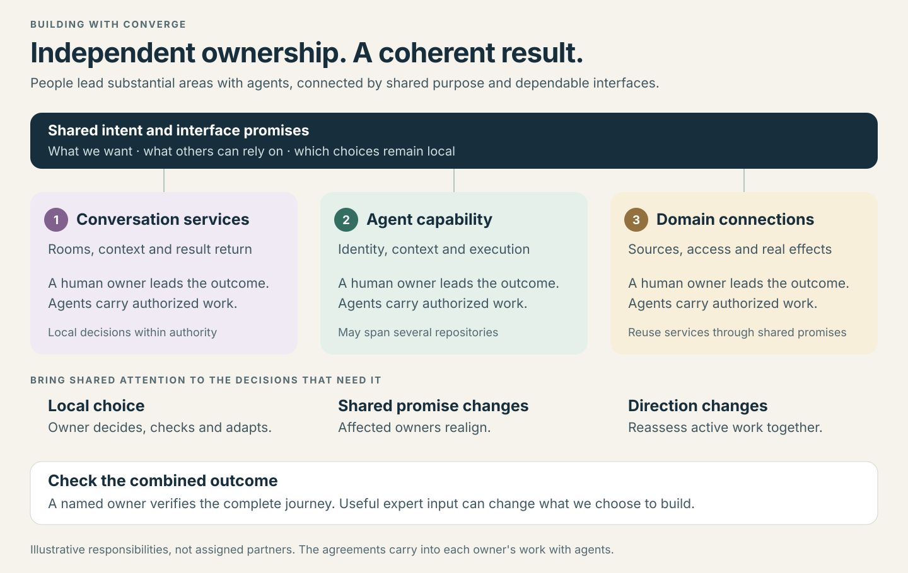

# Building Constellation together

Use [Amplifier Converge](https://github.com/microsoft/amplifier-converge) to lead
substantial areas with agents. Its [people guide](https://github.com/microsoft/amplifier-converge/blob/main/guides/people-guide.md)
and [agent guide](https://github.com/microsoft/amplifier-converge/blob/main/guides/agent-guide.md)
own the method; this page is an entry point for this project.

Start with the [vision](VISION.md), then the [contracts](../contracts/README.md)
relevant to your next outcome. Use [family.toml](../family.toml) to find the
serving owners. Inspect current behavior to establish what needs to change; no
one needs the entire conversation history or a maintained inventory of gaps.

## Take responsibility for an outcome

One owner may lead several repositories or an assembly. In the existing
assignment, issue or PR, make clear:

- The useful outcome, responsible owner and delegated authority.
- The connections and people it depends on.
- The combined check, limits and next step if it cannot finish.

For example: make a correction reach an accepted task, preserve useful progress
and return the corrected result to its original conversation. That outcome can
span an experience, routing, an engine and domain actions. Each owner leads their
part; the outcome owner checks that they work together.

## Agree where responsibilities meet

A colleague joining to shape human experiences needs the ambition, relevant
promises and choices still open—not every implementation detail. They might
challenge how much agent coordination people must follow. Settle that shared
behavior in its owning contract, then let owners develop their areas independently.

Ordinary implementation choices proceed within delegated authority. A changed
shared promise needs agreement from affected owners before dependent work relies
on it. Carry the change into active assignments and checks; continue unaffected
work. Bring expertise a concrete outcome and question, with room to challenge both.

## Judge the whole

Exercise a complete journey, including correction, interruption and uncertainty.
A passing protocol test and a useful human experience establish different things.
Report the outcome and material limits, with evidence available to inspect.

Keep evidence that supports a current claim, decision or reusable check. Prune
obsolete explanation and duplicated promises. Component visions explain their
contribution and link shared agreements; they do not copy the umbrella.

Use the [Converge reviewer guide](https://github.com/microsoft/amplifier-converge/blob/main/guides/reviewer-guide.md)
for a newcomer walkthrough and a shared-boundary change. This guidance adds no
permissions or approval gates.
